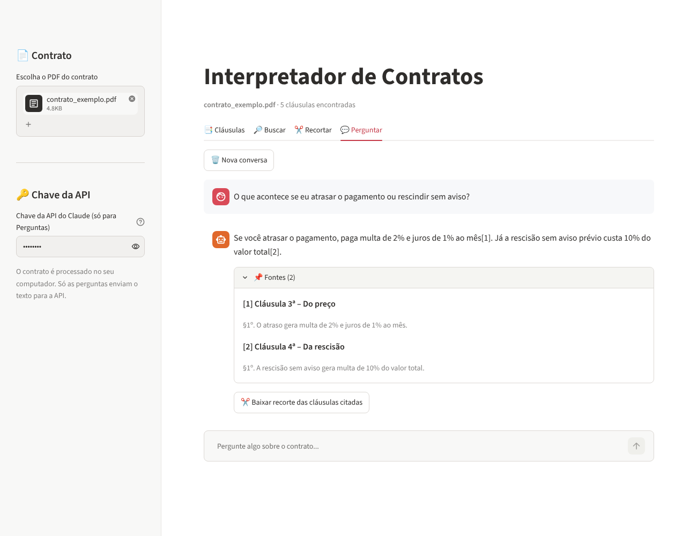
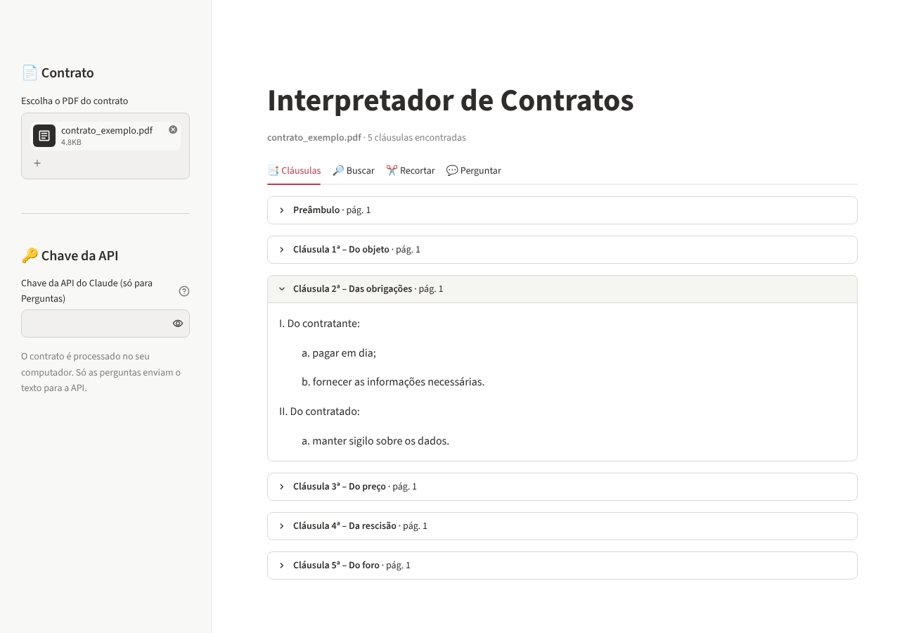
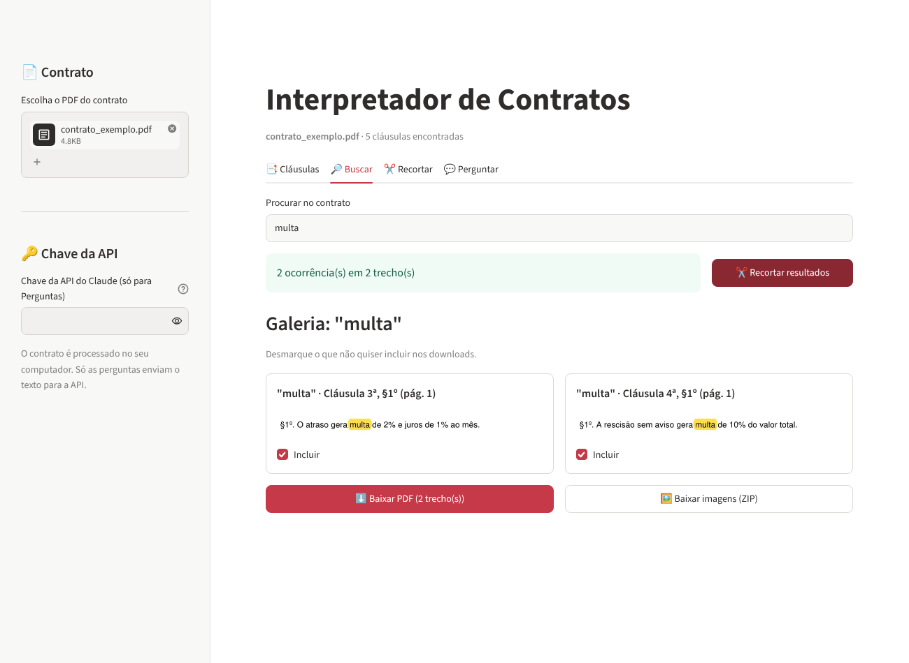
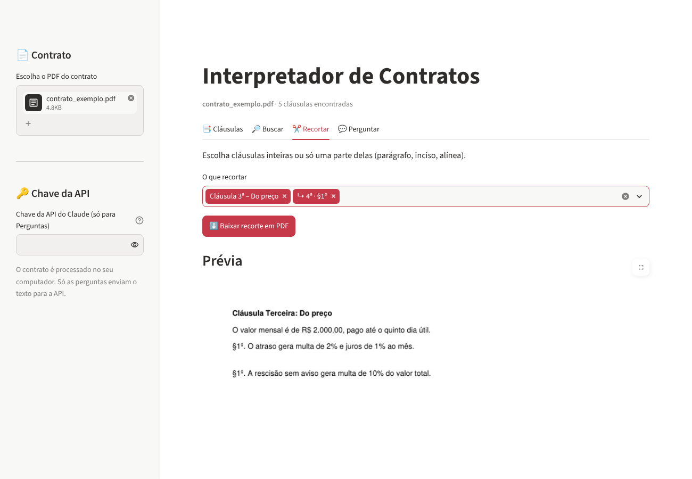

# Interpretador de Contratos

Programa em Python que lê contratos em PDF e ajuda a entendê-los:

- **Cláusulas organizadas**: identifica cláusulas, parágrafos (§), incisos e alíneas.
- **Busca com galeria**: encontra termos ignorando acentos e maiúsculas e, com um clique,
  recorta cada trecho encontrado numa galeria de imagens com título (termo, cláusula e página)
  e a palavra marcada em amarelo. Baixa tudo em PDF ou as imagens em ZIP.
- **Recorte visual**: gera um PDF só com as cláusulas (ou partes delas) escolhidas,
  usando o pedaço original da página, com a formatação preservada.
- **Perguntas com IA**: responde dúvidas com a API do Claude, **citando as cláusulas**
  que sustentam a resposta e gerando o recorte delas automaticamente.



| Cláusulas | Busca (galeria) | Recorte |
|---|---|---|
|  |  |  |

> As imagens usam o contrato fictício de `exemplos/contrato_exemplo.pdf`.

## Como usar (Windows)

1. Instale o [Python](https://www.python.org/downloads/) marcando **"Add python.exe to PATH"**.
2. Clique duas vezes em **`Instalar.bat`** (só na primeira vez).
3. Clique duas vezes em **`Abrir Interpretador.bat`**. O programa abre no navegador.
4. Para fazer perguntas, cole sua chave da API do Claude na barra lateral
   (crie em [platform.claude.com](https://platform.claude.com)).

O contrato é processado no seu computador; só as perguntas enviam o texto à API.

## Como funcionam as citações

Cada cláusula é enviada como um bloco de um documento (*custom content*) com o recurso
**Citations** da API ativado. Quando o Claude cita um trecho, a API devolve o índice do
bloco — que aponta direto para a cláusula e suas coordenadas no PDF. Assim o programa sabe,
sem adivinhar, quais cláusulas sustentam a resposta e consegue recortá-las.

## Linha de comando (opcional)

```bash
contratos listar contrato.pdf
contratos ver contrato.pdf 4
contratos buscar contrato.pdf multa
contratos recortar contrato.pdf 4 5:§2 2:II,b -o recorte.pdf
contratos perguntar contrato.pdf "Qual a multa por atraso?" --recortar citadas.pdf
```

## Para desenvolvedores

```bash
python -m venv .venv
.venv\Scripts\activate         # Linux/Mac: source .venv/bin/activate
pip install -e ".[dev]"
pytest
contratos-app                  # abre a interface
```

```
src/contratos/
├── ingestao/leitor.py       # extrai linhas com página e coordenadas (PyMuPDF)
├── estrutura/clausulas.py   # cláusulas, §, incisos, alíneas e busca
├── exportacao/recorte.py    # recorte visual em PDF novo (títulos e marca-texto opcionais)
├── exportacao/galeria.py    # resultados da busca agrupados + imagens + ZIP
├── ia/perguntas.py          # perguntas com a API do Claude + citações
├── app.py                   # interface (Streamlit)
└── cli.py                   # linha de comando
```

Os testes usam apenas contratos fictícios. A camada de IA é testada com um cliente falso
e com o SDK oficial sobre HTTP simulado, sem gastar créditos.

## Licença

AGPL-3.0 (exigida pelo PyMuPDF).
